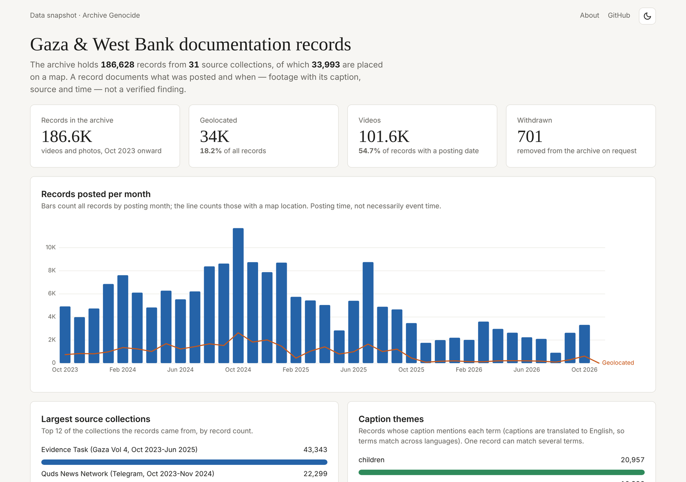

# Gaza Documentation Archive — dashboard

A static dashboard of the [Archive Genocide](https://archivegenocide.com/) records: footage and photos posted from Gaza and the West Bank since October 2023, broken down by month, source collection, caption theme and map location, with a focused look at geolocated records that mention hospitals.

**Live site:** https://virgosuperclusterfuck.github.io/imperiyalismo-ibagsak/

[](https://github.com/virgosuperclusterfuck/imperiyalismo-ibagsak/actions/workflows/pages.yml)
[](https://github.com/virgosuperclusterfuck/imperiyalismo-ibagsak/actions/workflows/refresh-data.yml)



> A record documents **what was posted and when** — footage with its caption, source and posting time. It is not a verified finding about an event. See [Reading the numbers](#reading-the-numbers).

## What's on the page

| Section | Shows |
|---|---|
| Headline figures | Total records, geolocated records, videos, and records withdrawn on request |
| Records posted per month | All records (bars) and geolocated records (line) by posting month |
| Largest source collections | The 12 collections with the most records |
| Caption themes | How many captions mention terms such as *children*, *camp*, *hospital*, *airstrike* |
| Hospital focus | Geolocated records whose caption mentions "hospital": per month, by location precision, and plotted by coordinates |
| Records table | The hospital slice, searchable, newest first, linking to each record on the archive when available |
| Download the data | The exact CSV/JSON files the page draws from |

Everything is plain HTML, CSS and JavaScript with [d3 v7](https://d3js.org/) bundled locally. No build step, no framework, no tracking, no cookies.

## Run it locally

The page loads its data with `fetch`, so open it through a local web server rather than double-clicking `index.html`:

```bash
git clone https://github.com/virgosuperclusterfuck/imperiyalismo-ibagsak.git
cd imperiyalismo-ibagsak
python3 -m http.server 8000
# open http://localhost:8000
```

## Publish on GitHub Pages

1. Push this folder to the `main` branch of [`virgosuperclusterfuck/imperiyalismo-ibagsak`](https://github.com/virgosuperclusterfuck/imperiyalismo-ibagsak) (the repository must be public for free GitHub Pages):
   ```bash
   git init -b main
   git add .
   git commit -m "Initial commit"
   git remote add origin https://github.com/virgosuperclusterfuck/imperiyalismo-ibagsak.git
   git push -u origin main
   ```
   If the repository already has a commit (for example a README GitHub created for you), run `git pull origin main --allow-unrelated-histories` before pushing and keep this version of any file that conflicts.

   Uploading through the GitHub website also works, but make sure the hidden `.github/` folder and `.nojekyll` file go up too — Finder and Explorer hide them by default, and without them nothing deploys.
2. In the repository, open **Settings → Pages** and set **Source** to **GitHub Actions**.
3. Open **Settings → Actions → General → Workflow permissions** and choose **Read and write permissions** (the daily refresh needs to commit new data).
4. The **Deploy to GitHub Pages** workflow runs on that first push. When it finishes, the site is live at the address above.

## Keeping the data current

The files in `data/` are a snapshot. `scripts/refresh.py` rebuilds them from the archive's public API, and the **Refresh data** workflow runs it every day at 10:17 UTC, commits any changes, and redeploys the site.

```bash
python3 scripts/refresh.py            # rebuild data/ (about 3–5 minutes)
python3 scripts/refresh.py --dry-run  # fetch everything, write nothing
```

- Python 3.9+ standard library only; nothing to install.
- Paced to stay under the API's limit of 120 requests per minute and honours `Retry-After`.
- The API counts at most 10,000 matches per search, so larger counts are split into date ranges and summed.
- Every id listed by `/v1/withdrawn` is removed from the records written, as the archive's terms ask.
- If any request fails, nothing is written. If the hospital slice shrinks by more than half, the script stops and asks for `--allow-shrink`, since that is far more likely an API problem than real data.

To run a refresh by hand: **Actions → Refresh data → Run workflow**.

## Reading the numbers

- **Posting time, not event time.** Dates are when the source posted the footage, in the source's time zone.
- **Geolocation has levels.** Precision 1–3 places a record at a town, neighbourhood or named building that hasn't been verified on the ground; only precision 4 (`exact = true`) marks a specific site. The scatter plot shows the difference.
- **Caption themes are word matches** on English captions (translated where needed). One record can match several terms, and a match is not a classification.
- **Review status** (`high` / `medium` / `low`) is the archive's internal review of how closely a clip matches its documentation — not a judgement on whether an event happened.
- **Videos and photos** are counted from month-by-month totals, so they cover only records with a posting date.

Column definitions and how each file is built: [DATA.md](DATA.md).

## Project structure

```
.
├── index.html                  # the page
├── assets/
│   ├── css/style.css           # layout and light/dark theme
│   ├── js/runtime.js           # loads data/, computes derived values, redraws on change
│   ├── js/dashboard.js         # every number, chart and table
│   └── vendor/d3.min.js        # d3 v7.9.0 (ISC licence)
├── data/                       # snapshot the page reads (see DATA.md)
├── scripts/refresh.py          # rebuilds data/ from the API
├── docs/screenshot.png
└── .github/
    ├── workflows/pages.yml         # deploy to GitHub Pages
    ├── workflows/refresh-data.yml  # daily data refresh
    ├── dependabot.yml
    ├── ISSUE_TEMPLATE/
    └── pull_request_template.md
```

## Data source and attribution

All records come from **Archive Genocide ([archivegenocide.com](https://archivegenocide.com/))** through its public [API](https://archivegenocide.com/api-docs/). The archive's terms, which this project follows:

- Records (ids, dates, captions, sources, locations) are free to use, share and build on, with credit to Archive Genocide and a link to each record's page where possible.
- Footage belongs to its filmers and captions to their authors.
- Many people shown are victims or children. Don't use these records to harass, mock or expose anyone, or to identify private individuals except to document crimes against them.
- Withdrawn clips must be removed from any copy — the daily refresh does this.

This repository holds no footage, only record metadata and captions.

## Contributing

Corrections and improvements are welcome — see [CONTRIBUTING.md](CONTRIBUTING.md). For a problem with a record itself (a wrong date, location or caption), contact the archive directly; this project only mirrors it.

## Licence

The code is released under the [MIT Licence](LICENSE). The data in `data/` is **not** covered by that licence: it comes from Archive Genocide under the terms above. d3 is © Mike Bostock, ISC licence (`assets/vendor/d3.LICENSE`).

If you use this dashboard in your work, see [CITATION.cff](CITATION.cff).
